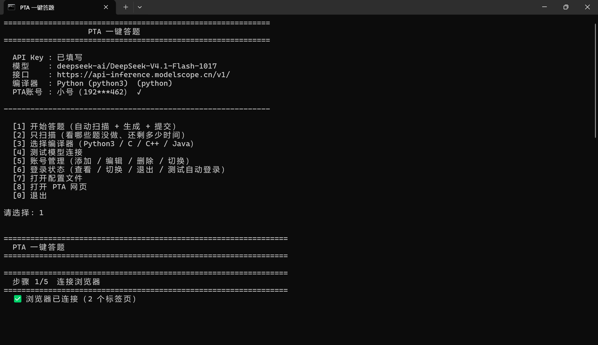

# PTA 一键答题

通过 Chrome DevTools Protocol 操控浏览器，自动完成 PTA（拼题A）作业：扫描题目 → AI 生成代码 → 本地跑样例验证 → 自动提交 → 读回评测分数。

全程**不需要模拟鼠标键盘**，浏览器可以在后台跑。



---

## 特性

- **自动扫描作业**：只列出带截止时间的真作业，教材/练习题集不扫
- **AI 生成代码**：支持任意 OpenAI 兼容接口（DeepSeek / 魔搭 / 硅基流动 / 中转站）
- **提交前本地验证**：用真实编译器跑题面给的样例，逐字符比对，通过才提交
- **四种语言**：Python3 / C / C++ / Java，各有专门的提示词
- **后台运行**：切题、写代码、切编译器、提交全部走纯 JS，不抢前台
- **多账号管理**：保存多个 PTA 账号，一键切换
- **自动登录**：保存账号密码，cookie 过期后自动重登

---

## 这个项目建立在什么基础上

本项目的浏览器自动化思路参考并改进了以下项目：

- **[PTA Auto Solver](https://github.com/NeuronCState/PTA-Auto-Solver)** —— 一个运行在 PTA 页面上的 Tampermonkey AI 辅助答题脚本。本项目借鉴了它「读题干 → 调 AI → 写入编辑器 → 提交评分」的流程设计，但放弃了油猴脚本形态，改为独立的 Python + CDP 方案，以便：
  - 支持批量处理整个作业（而不是一题一题手动点）
  - 提交前在本地用真实编译器验证（油猴脚本做不到）
  - 后台运行，不抢占用户窗口

> 如果你只需要浏览器内手动逐题作答，推荐直接用 PTA Auto Solver。

---

## 工作原理

```
┌─────────────────┐
│  调试浏览器      │  ← 需带 --remote-debugging-port=9222 启动
│  (已登录 PTA)    │
└────────┬────────┘
         │ CDP (WebSocket)
         ▼
┌─────────────────┐
│  pta_core.py    │  读题面 / 切题 / 写代码 / 切编译器 / 提交 / 读结果
└────────┬────────┘
         │
         ▼
┌─────────────────┐
│  pta_ai.py      │  解析样例 → 调模型 → 提取代码 → 本地验证
└────────┬────────┘
         │
         ▼
┌─────────────────┐
│  本地编译器      │  Python / gcc / g++ / javac
│  (验证样例)      │
└─────────────────┘
```

### 为什么不用模拟点击

PTA 页面上有 **5 个 CodeMirror 编辑器**，其中 4 个是题面的只读样例框，只有第 5 个（`contenteditable=true` 且 `readOnly=false`）才是答题框。

用模拟点击容易写错框。本项目直接拿 CodeMirror 的 `EditorView` 实例调 `dispatch()`，精确且可回读校验。

### 为什么切编译器不用模拟输入

PTA 的编译器下拉是 `react-select`，它的菜单只能被真实键盘/鼠标事件打开。本项目改为从 React Fiber 上找到组件实例，直接调内部方法 `selectOption()`：

```js
let fiber = root.__reactFiber$xxx;
while (fiber) {
  const sn = fiber.stateNode;
  if (sn && typeof sn.selectOption === 'function') { inst = sn; break; }
  fiber = fiber.return;
}
inst.selectOption(targetOption);   // 不产生任何输入事件
```

---

## 快速开始

### 1. 准备调试浏览器

需要一个带调试端口的 Chrome。新建一个批处理文件：

```bat
@echo off
set CHROME=C:\Program Files\Google\Chrome\Application\chrome.exe
set PROFILEDIR=D:\ChromeDebug

start "" "%CHROME%" ^
 --remote-debugging-port=9222 ^
 --remote-allow-origins=* ^
 --user-data-dir="%PROFILEDIR%" ^
 --no-first-run ^
 --no-default-browser-check
```

双击运行后，在弹出的浏览器里登录 PTA（只需一次）。

### 2. 安装依赖

```bash
pip install websockets
```

Python 3.8+。

### 3. 配置

复制模板并填写：

```bash
cp config.example.json config.json
```

```json
{
  "baseUrl": "https://api.deepseek.com/v1",
  "apiKey": "你的 API Key",
  "model": "deepseek-chat",

  "pta": {
    "账号列表": [
      { "名字": "主号", "账号": "你的账号", "密码": "你的密码" }
    ],
    "当前账号": "主号",
    "自动登录": true
  }
}
```

**支持的模型服务**（任何 OpenAI 兼容接口都行）：

| 服务商 | baseUrl | model 示例 |
|---|---|---|
| DeepSeek | `https://api.deepseek.com/v1` | `deepseek-chat` |
| 魔搭 ModelScope | `https://api-inference.modelscope.cn/v1/` | `deepseek-ai/DeepSeek-V3` |
| 硅基流动 | `https://api.siliconflow.cn/v1` | `deepseek-ai/DeepSeek-V3` |
| 阿里百炼 | `https://dashscope.aliyuncs.com/compatible-mode/v1` | `qwen-plus` |

### 4. 运行

```bash
python pta_run.py
```

按提示操作。

---

## 使用流程

```
步骤 1/5  连接浏览器
          ✅ 自动连接 9222 端口的调试浏览器

步骤 2/5  检查登录状态
          ✅ 已登录（未登录则自动用保存的账号登录）

步骤 3/5  扫描作业
          [1] ★ CTPY-05         将于 2 分钟后关闭
          [2] ★ py05作业--列表   将于 11-15 关闭

步骤 4/5  扫描题目
          进度：████████░░  8/10
          5-1  大于身高的平均值   10分  ⬜ 未做
          5-2  输出10个不重复的字母 10分  ✅ 已完成
          ...

步骤 5/5  自动答题
          [1/2] 5-1
            题面 381 字 → 样例 2 个
            生成 Python3 代码…（10.8s，1 次）
            ✅ 样例验证通过
            编译器：Python (python3)
            已填入 274 字符
            已提交，等评测…
            ✅ 答案正确 10/10
```

---

## 常用脚本

| 脚本 | 用途 |
|---|---|
| `pta_run.py` | **主程序**，完整流程 |
| `pta_scan.py` | 只扫描，看哪些题没做、还剩多久 |
| `pta_rerun.py <setId>` | 重跑某个作业里未通过的题 |
| `pta_compiler.py` | 选编译器（Python3 / C / C++ / Java） |
| `pta_setaccount.py` | 管理 PTA 账号（增删改切换） |
| `pta_account.py` | 查看登录状态、切换账号、退出 |
| `pta_test.py` | 测试模型连接是否正常 |

---

## 配置项说明

```json
{
  "baseUrl": "接口地址（以 /v1 结尾）",
  "apiKey": "密钥",
  "model": "模型名",

  "pta": {
    "账号列表": [
      { "名字": "显示名", "账号": "登录账号", "密码": "登录密码" }
    ],
    "当前账号": "用哪个账号",
    "自动登录": true,
    "等待滑块秒数": 90
  },

  "生成参数": {
    "temperature": 0.2,       // 越低越稳定，答题建议 ≤0.2
    "maxTokens": 4096,
    "超时秒数": 180
  },

  "答题设置": {
    "语言": "python",          // 自动从编译器推导
    "编译器": "python3",       // python3 / c / cpp / java
    "自动提交": true,          // false = 只填入不提交
    "样例不通过时最多重试次数": 2,
    "样例不通过是否仍提交": false   // 危险选项，默认关
  },

  "浏览器": {
    "调试端口": 9222
  }
}
```

---

## 关键设计：样例不通过不提交

```
模型生成代码
     ↓
本地用真实编译器跑题面给的每个样例
     ↓
逐字符比对输出（空格、小数位数、换行都算）
     ↓
  ┌──┴──┐
 一致   不一致
  ↓      ↓
提交   把「期望 vs 实际」喂回模型重试
        ↓
      仍不一致 → 跳过，不污染提交记录
```

想强制提交可以设 `"样例不通过是否仍提交": true`，但不建议。

---

## 提示词里的代码风格约束

为避免模型写出花哨但容易出错的代码，提示词强制要求：

- 只用最基础的语法（不用推导式嵌套、装饰器、生成器、lambda 链、海象运算符）
- 不导入复杂包（Python 只允许 `sys` / `math`；C/C++ 只允许基础头文件）
- 代码要短，不写多余注释
- 不写函数封装，除非题目明确要求

---

## 常见问题

**连不上调试浏览器**

检查是否用 `--remote-debugging-port=9222` 启动。可以访问 `http://127.0.0.1:9222/json/version` 验证。

**所有标签页调试通道被占用**

Chrome 的 CDP 同一个标签页同时只能被一个客户端连接。关掉其他占用 9222 的工具（如 Playwright MCP）。

**编译器切不过去**

标签页必须在可见状态（react-select 的限制）。本项目已改为纯 JS 方式，正常情况下不需要标签页在前台。

**评测超时**

PTA 有时判题慢。可以稍后到页面上手动确认，或调大 `wait_result` 的超时。

**样例通过但 PTA 判错**

PTA 的隐藏测试点可能覆盖样例没涉及的情况。常见原因：
- 尾随空格（题面要求「每个数后面有空格」时，`" ".join()` 会漏掉最后一个空格）
- 边界值（0、负数、空输入）
- 多组输入数据的读取

---

## 免责声明

本项目仅供**个人学习和技术研究**使用。

请遵守所在学校/机构的学术诚信规定。用自动化工具完成作业可能违反课程要求，由此产生的后果由使用者自行承担。

---

## License

MIT
